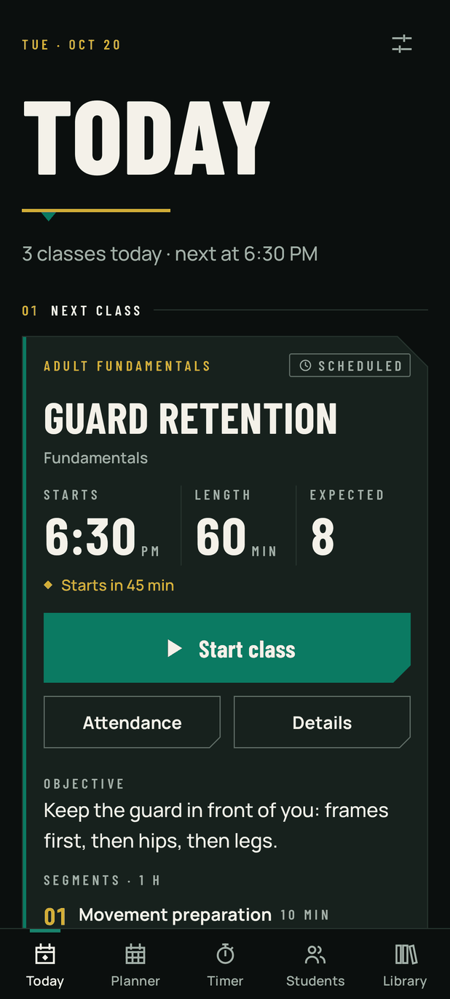
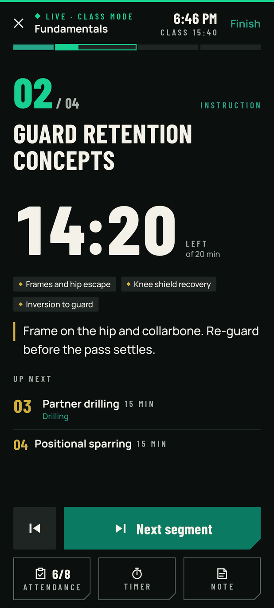
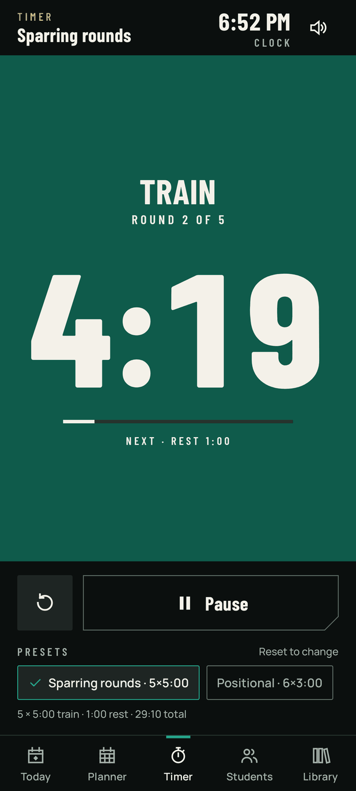
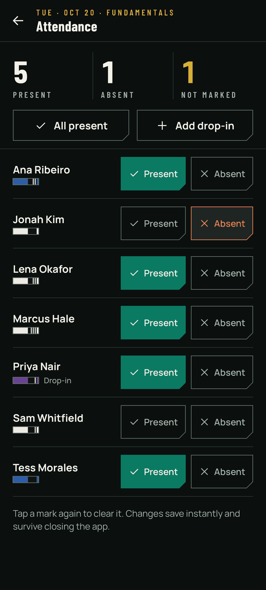

# Kaiju Coach

A private Android app for teaching Brazilian Jiu-Jitsu, part of the **Earl the Kaiju** ecosystem.
Built by Earl Hickson Jr. — BJJ black belt, instructor, graphic designer and front-end developer.

Kaiju Coach keeps what I need on the mat in one place: today's class, lesson plans, a round timer,
attendance and my roster. It works with no internet connection, and student data stays on the phone.

> **Status — Sprint 01** (branch `sprint/01-foundation`): functional MVP of Today, Planner, Lesson
> builder, Class Mode, Timer, Students, Attendance, Technique library and Settings; media library and
> desktop sync are designed, not built. `main` stays stable.

| Today | Class Mode | Timer | Attendance |
|---|---|---|---|
|  |  |  |  |

Every screenshot is rendered from the real Compose code by CI (Roborazzi), with fictional data.
All 45 screen states are in [`docs/screenshots/sprint-01`](docs/screenshots/sprint-01/README.md).

## Repository layout

| Folder | What it holds |
|---|---|
| `android/` | The Android app (Kotlin, Jetpack Compose, Room). Open this folder in Android Studio. |
| `docs/` | Product brief, architecture, design system, screen specs, data model, sync plan, timer behavior, QA review, decisions, case-study log, screenshots. |
| `contracts/` | Data contracts shared with the planned desktop companion (backup / sync record format). |
| `assets/brand/` | The approved Earl the Kaiju brand sources the app uses, with provenance and conversion tools. |
| `desktop/` | Placeholder for the planned React + TypeScript desktop companion. |

The public website is a separate project and is not part of this repository.

## Build and run

Requirements: a current Android Studio release that supports AGP 9.3 (it will offer to download
Gradle 9.5 and SDK 37 on first sync), JDK 17+, and an Android 8.0+ phone or emulator.

```bash
cd android
./gradlew assembleDebug          # app/build/outputs/apk/debug/app-debug.apk
./gradlew testDebugUnitTest      # unit + Robolectric tests
./gradlew recordRoborazziDebug   # re-render every screen into app/build/outputs/roborazzi/
./gradlew lintDebug
```

Or download the debug APK from the latest successful run in the repository's **Actions** tab
(artifact `kaiju-coach-debug-apk`) and install it on the phone. The debug build installs alongside
any future release build (`com.earlthekaiju.coach.debug`) and has **Settings › Load sample data**
for trying the app with fictional students.

## Documentation

1. [Product brief](docs/01-product-brief.md)
2. [Architecture](docs/02-architecture.md) and [decisions](docs/decisions.md)
3. [Design system](docs/03-design-system.md)
4. [Screen specifications](docs/04-screen-specs.md)
5. [Data model and ERD](docs/05-data-model.md)
6. [Local Wi-Fi sync architecture](docs/06-sync-architecture.md)
7. [Timer: Android behavior and limits](docs/07-timer-platform-behavior.md)
8. [QA review](docs/08-qa-review.md)
9. [Dependency verification](docs/09-dependency-verification.md)
10. [Case-study log](docs/case-study-log.md)

## Privacy

No real student records, credentials, keystores or private media are committed. Android cloud
backup is disabled for the app; backups are explicit JSON exports the instructor saves. See
[`NOTICE.md`](NOTICE.md) for code, brand and font ownership.
