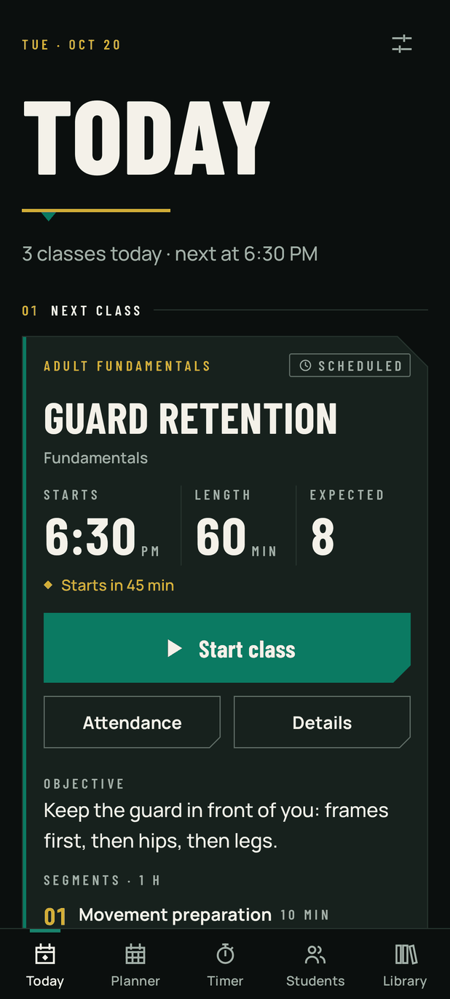
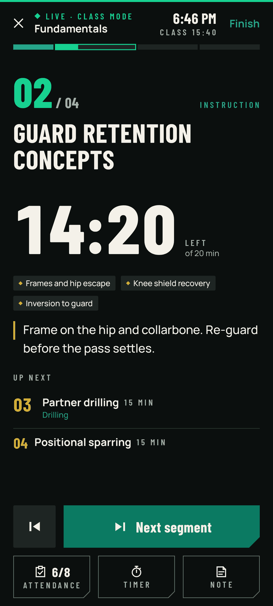
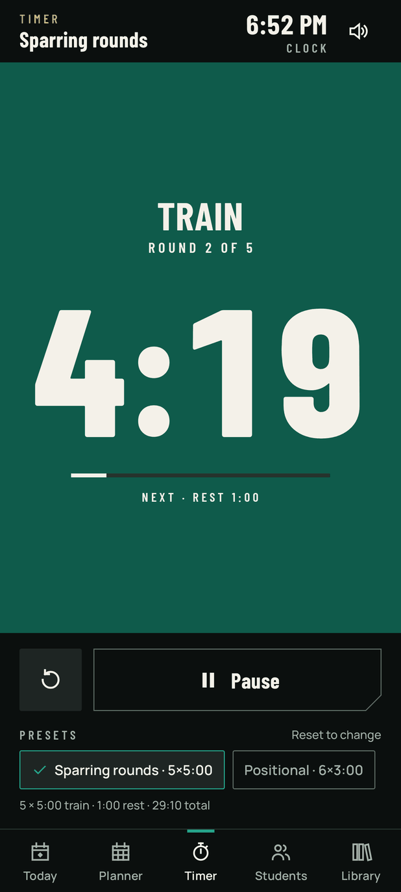
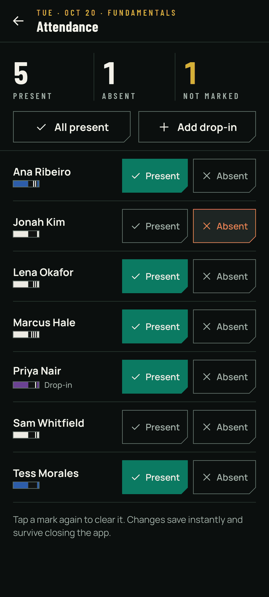

# Kaiju Coach

A private Android app for teaching Brazilian Jiu-Jitsu, part of the **Earl the Kaiju** ecosystem.
Built by Earl Hickson Jr. — BJJ black belt, instructor, graphic designer and front-end developer.

Kaiju Coach keeps what I need on the mat in one place: today's class, lesson plans, a round timer,
attendance and my roster. It works with no internet connection, and student data stays on the phone.

> **Status:** Sprints 01–03 are merged into `main`. They cover Today, Planner, Lesson builder,
> Class Mode, Timer (it keeps running and sounding with the phone locked), Students, Attendance,
> Technique library, a private video library and Settings. Desktop sync is designed, not built.
> Every merge into `main` that passes CI becomes a signed personal build for my phone
> ([install it](#install-it-on-your-phone)).
>
> **Evaluating this project?** Start with the [project wiki](docs/wiki/README.md): the problem,
> design, architecture, key decisions, quality and lessons, with links into the detailed docs.

| Today | Class Mode | Timer | Attendance |
|---|---|---|---|
|  |  |  |  |

Every screenshot is rendered from the real Compose code by CI (Roborazzi), with fictional data.
All 45 screen states are in [`docs/screenshots/sprint-01`](docs/screenshots/sprint-01/README.md); full-screen captures from the emulator run are in [`device/`](docs/screenshots/sprint-01/device/README.md).

## Repository layout

| Folder | What it holds |
|---|---|
| `android/` | The Android app (Kotlin, Jetpack Compose, Room). Open this folder in Android Studio. |
| `docs/` | Product brief, architecture, design system, screen specs, data model, sync plan, timer behavior, QA review, decisions, case-study log, screenshots. |
| `contracts/` | Data contracts shared with the planned desktop companion (backup / sync record format). |
| `assets/brand/` | The approved Earl the Kaiju brand sources the app uses, with provenance and conversion tools. |
| `desktop/` | Placeholder for the planned React + TypeScript desktop companion. |

The public website is a separate project and is not part of this repository.

## Install it on your phone

On the Android phone, open this link in Chrome:
**https://github.com/Epetaway/earltheKaiju_app/releases/latest/download/kaiju-coach.apk**

Allow Chrome to install unknown apps when Android asks, then tap Install. The same link always
gets the newest build, and an update installs over the app without touching its data. Full steps,
what to do if an install is refused, and how signing works:
[docs/10-personal-builds.md](docs/10-personal-builds.md).

## Build and run

Requirements: a current Android Studio release that supports AGP 9.3 (it will offer to download
Gradle 9.5 and SDK 37 on first sync), JDK 17+, and an Android 8.0+ phone or emulator.

```bash
cd android
./gradlew assembleDebug          # app/build/outputs/apk/debug/app-debug.apk
./gradlew testDebugUnitTest      # unit + Robolectric tests
./gradlew recordRoborazziDebug   # re-render every screen into app/build/outputs/roborazzi/
./gradlew lintDebug
```

The debug build is **Kaiju Test** (`com.earlthekaiju.coach.debug`). It installs beside the
personal build with its own data, and it has **Settings › Load sample data** for trying the app
with fictional students. CI's debug APK is also in each run's **Actions** artifacts
(`kaiju-coach-debug-apk`).

### Run it on your phone

Connect an Android phone to the Mac, either over USB with USB debugging on or over Wi‑Fi with
wireless debugging (`adb pair`, then `adb connect`). Put CI's two APKs (or your own
`assembleDebug assembleDebugAndroidTest` outputs) in `device-test/apk/`, then:

```bash
bash android/scripts/run-on-phone.sh
```

It installs Kaiju Test and runs the full class-flow test on the phone, with accessibility
checks. Screenshots and logs go to `device-test/<time>/`, which is git-ignored because they show
your status bar. Kaiju Test stays installed afterward, and the personal build is never touched.
CI debug builds share one signing key, so each installs over the last. If the Kaiju Test on the
phone was signed by another key, the script stops rather than uninstalling it and deleting its
data.

## Documentation

1. [Product brief](docs/01-product-brief.md)
2. [Architecture](docs/02-architecture.md) and [decisions](docs/decisions.md)
3. [Design system](docs/03-design-system.md)
4. [Screen specifications](docs/04-screen-specs.md)
5. [Data model and ERD](docs/05-data-model.md)
6. [Local Wi-Fi sync architecture](docs/06-sync-architecture.md)
7. [Timer: Android behavior and limits](docs/07-timer-platform-behavior.md)
8. [QA review](docs/08-qa-review.md)
9. [Dependency verification](docs/09-dependency-verification.md)
10. [Personal builds: install, update, signing](docs/10-personal-builds.md)
11. [Case-study log](docs/case-study-log.md)

## Privacy

No real student records, credentials, keystores or private media are committed. Signing keys
live only in a GitHub Actions secret and the owner's password manager. Android cloud backup is
disabled for the app; backups are explicit JSON exports the instructor saves. See
[`NOTICE.md`](NOTICE.md) for code, brand and font ownership.
