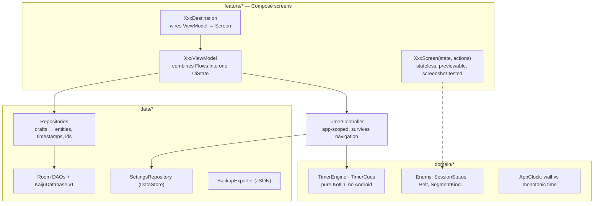

# 02 · Architecture

A single Android app module, organized by feature, with a thin data layer over Room. Built for one
instructor and one maintainer: every layer earns its place.

## Stack

| Concern | Choice | Version |
|---|---|---|
| Language | Kotlin (AGP 9 built-in Kotlin) | 2.4.20 |
| UI | Jetpack Compose + Material 3 (as a foundation, restyled) | BOM 2026.09.00 |
| Navigation | Navigation Compose, type-safe `@Serializable` routes | 2.10.2 |
| Local data | Room on SQLite, KSP2 code generation | 2.8.5 / KSP 2.3.12 |
| Preferences | DataStore Preferences | 1.2.1 |
| Async | Coroutines + Flow, `StateFlow` UI state | 1.11.0 |
| Serialization | kotlinx.serialization (routes, backup JSON) | 1.12.0 |
| DI | Manual container (`AppContainer`) | — |
| Tests | JUnit 4, Robolectric, Roborazzi screenshots | 4.17 / 1.76.0 |
| Build | AGP 9.3.3, Gradle 9.5.0, JDK 21 on CI | — |

Versions were checked against official release pages on 2026-10-20 and proven by a green CI
build; see [09-dependency-verification.md](09-dependency-verification.md).

## Layers



**Rules**

- Screens are pure functions of a `UiState` plus an actions object. They never touch a
  ViewModel, a repository or `Context`, which is why every screen can be rendered in a test with
  fixed fictional data.
- ViewModels expose one `StateFlow<UiState>` built with `combine`/`flatMapLatest`; writes go
  through repositories.
- Repositories are the only place that creates ids and timestamps, so sync metadata is always
  consistent.
- `domain/` has no Android dependencies except `AppClock`'s system implementation, so the timer
  logic runs in plain JVM tests (and runs locally without an emulator).

## Packages

```
com.earlthekaiju.coach
├── designsystem/   theme (colors, type, shapes, spacing), icon/, component/
├── navigation/     Routes.kt (type-safe routes), KaijuApp.kt (shell, bars, NavHost)
├── domain/         model/ (enums), time/ (clocks, ids), timer/ (engine + cues)
├── data/           db/ (entities, DAOs, database), repo/, prefs/, backup/, sample/
├── di/             AppContainer, kaijuViewModel()
├── ui/             formatting, mappers, composition locals
└── feature/
    ├── today/       dashboard
    ├── planner/     week planner, session editor & detail, shared NoteSheet
    ├── lessons/     lesson builder
    ├── classmode/   Class Mode, post-class
    ├── timer/       TimerController, ToneCuePlayer, timer screen
    ├── students/    roster, editor, detail
    ├── attendance/  attendance with undo
    ├── library/     techniques, media concept
    └── settings/    settings, programs, backup export
```

One Gradle module is deliberate: build times stay low, there is no cross-module plumbing to
maintain, and package boundaries already keep features apart. The timer engine and data layer can
be lifted into modules later if the desktop companion ever shares Kotlin code (it won't for now:
it's TypeScript and shares the JSON contract instead).

## Navigation

- Five tabs, each its own nested graph so back stacks are saved and restored when switching tabs:
  Today, Planner, Timer, Students, Library. Settings is reached from the gear on each tab.
- Secondary screens (editors, details, Class Mode, Attendance) sit at the root and hide the
  bottom bar.
- Class Mode is immersive: no bottom bar, a live band at the top, screen kept on. Leaving it does
  not stop the class; finishing replaces it with the post-class screen.
- Windows 600dp and wider (tablets, phones in landscape) get a side rail instead of the bottom bar.
- Routes carry ids only. Each screen loads its own data, so process death and restore just work.

## Offline-first by construction

There is no network code in Sprint 01 and no `INTERNET` permission is used for any feature. All
state is Room + DataStore on the device. Cloud backup and device transfer are disabled so student
data is not copied to a Google account; the instructor exports a backup file deliberately.

## The timer

`TimerController` is created once in `AppContainer` (process lifetime), so the timer keeps
running across screens. It holds only anchors (start, pause), derives every snapshot from the
monotonic clock through `TimerEngine`, persists anchors to DataStore, and fires cues through a
`CuePlayer`. Platform behavior and limits: [07-timer-platform-behavior.md](07-timer-platform-behavior.md).

## Testing and CI

| Layer | Tool | Where |
|---|---|---|
| Timer engine, cues | JUnit (pure JVM) | `test/domain/timer` |
| Repositories, schema rules, restart persistence | Robolectric + real Room DB file | `test/data` |
| Timer restore after process death / reboot | JUnit + DataStore + virtual time | `test/feature/timer` |
| Every screen and the design system | Roborazzi (Robolectric native graphics) | `test/screenshots` |
| Lint | Android Lint, errors fail the build | CI |

The development environment can't reach Google's Maven repository, so **GitHub Actions is the build
machine**: each push assembles the debug APK, runs all tests, renders every screen and runs lint,
then publishes logs, a test summary, lint output, Room schemas and the screenshots to the
`ci-reports` branch (one folder per branch, replaced each run). The debug APK is also attached to
each run as an artifact for sideloading. See [decisions.md](decisions.md) (ADR-007).
