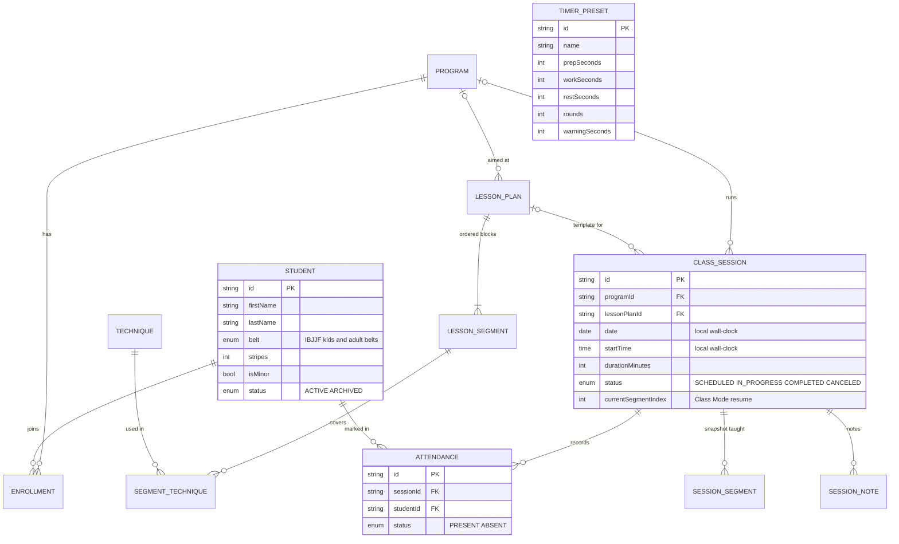

# 05 · Data model

Room (SQLite) on the phone is the source of truth. Schema version 1 is exported to
`android/app/schemas/` so every later version ships with a tested migration.

## Entity relationships

## The distinctions that matter

| Rule | How the schema enforces it |
|---|---|
| A scheduled class is not a lesson plan. | `class_session` references `lesson_plan` (nullable). The plan is a reusable template; the session is one dated occurrence. |
| A completed class keeps what was actually taught. | Starting a class copies the plan's segments and technique names into `session_segment`. Editing or deleting the template later never touches that copy. Tested in `RepositoryTest`. |
| An attendance record belongs to one student and one session. | `attendance` has a unique index on `(sessionId, studentId)` and foreign keys to both. |
| A student is not a website inquiry. | There is no inquiry table. Website inquiries (Cloudflare D1) stay in their own system and will arrive later as a separate entity, converted to a student only by a deliberate action. |
| Expected students come from programs, not from each class. | `enrollment (studentId, programId)`. A class's expected roster = active students enrolled in its program. Drop-ins appear once marked. |

## Common columns

Every top-level table carries:

| Column | Purpose |
|---|---|
| `id TEXT PRIMARY KEY` | Random UUID created on the device. Stable forever; never reused; no autoincrement, so phone and desktop records never collide. |
| `createdAt INTEGER` | Epoch ms (UTC). Never changes after insert. |
| `updatedAt INTEGER` | Epoch ms (UTC). Bumped on every edit; the basis for incremental sync. |
| `deletedAt INTEGER NULL` | Soft delete. The row stays as a tombstone so a future sync can tell the other device it was removed. All reads filter `deletedAt IS NULL`. |

Class dates and times are stored as **local wall-clock values** (`date` = `2026-10-20`, `startTime` =
`18:30`), not instants, so a Tuesday 6:30 PM class stays 6:30 PM across daylight-saving changes.
Timestamps of things that happened (`startedAt`, `markedAt`) are instants.

## Tables

| Table | Owns | Notes |
|---|---|---|
| `program` | — | Name, audience (adults, kids, teens, all ages, private), planner accent, sort order. |
| `lesson_plan` | `lesson_segment` | Title, optional program, target minutes, objective, notes, `isTemplate` (in the library or a one-off). |
| `lesson_segment` | `segment_technique` | Ordered by `position`. Title, minutes, kind (a label only), notes. |
| `technique` | — | Name, free-text category, notes. |
| `segment_technique` | — | Many-to-many with an order. |
| `class_session` | `session_segment`, `attendance`, `session_note` | Date, time, length, location, status, start/end instants, Class Mode position. |
| `session_segment` | — | The snapshot. Technique names stored as text on purpose. |
| `student` | `enrollment` | First/last name, belt + stripes, `isMinor`, status, one short teaching note. |
| `enrollment` | — | Student ↔ program. |
| `attendance` | — | PRESENT or ABSENT; "unmarked" is the absence of a live row. |
| `timer_preset` | — | Seeded once with four common formats; ordinary editable rows after that. |
| `session_note` | — | Notes written in Class Mode or after class. |

### What is deliberately *not* stored

No birth dates, addresses, phone numbers, emails, photos, medical information or payment data.
`isMinor` replaces a birth date. The teaching note's helper text tells the instructor not to put
medical, contact or family details there. Contact details belong to the website inquiry flow,
which already exists and has its own consent.

## Deletion behavior

| Action | Effect |
|---|---|
| Delete program | Tombstone; its enrollments are removed; **scheduled** classes lose the program; past classes keep it (shown without a name). |
| Delete lesson plan | Tombstone; scheduled classes are unassigned (the confirm dialog says how many); taught classes keep their snapshot. |
| Edit lesson plan | Affects only classes not yet started. |
| Delete technique | Tombstone; disappears from plans; taught classes keep the name in their snapshot. |
| Archive student | Leaves the roster, keeps history. Reversible. |
| Delete student permanently | Name and note are blanked, attendance marks are tombstoned, enrollments removed. A nameless tombstone remains only so sync can propagate the deletion. |
| Cancel class | Status CANCELED; stays visible, struck through. Reversible. |
| Delete class | Tombstone; its segments, attendance and notes are hidden with it. |

Hard purging of old tombstones is a later sync concern: once every paired device has seen a
deletion, its tombstone can be removed.

## Migrations

- `exportSchema = true`; the generated `1.json` is committed with the schema it describes.
- No `fallbackToDestructiveMigration()`. Losing a roster is not an acceptable failure mode.
- Each future version adds a `Migration(n, n+1)` (or an `@AutoMigration` with a spec when Room can
  infer it) and a test using `MigrationTestHelper` against the exported schemas, run in CI.
- Enum columns are stored by name. Renaming an enum constant is a migration.

## Backup format

Settings › Export backup writes every table, tombstones included, to a JSON file the instructor
chooses (Storage Access Framework). The format is versioned and described for the desktop
companion in [`contracts/kaiju-coach-backup.v1.schema.json`](../contracts/kaiju-coach-backup.v1.schema.json).
Restore is planned for Sprint 02 (see [06-sync-architecture.md](06-sync-architecture.md)).
