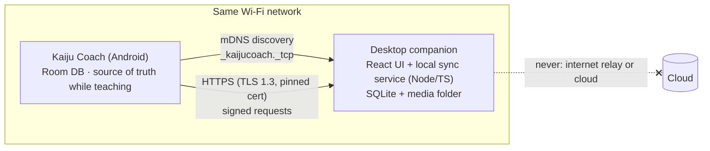
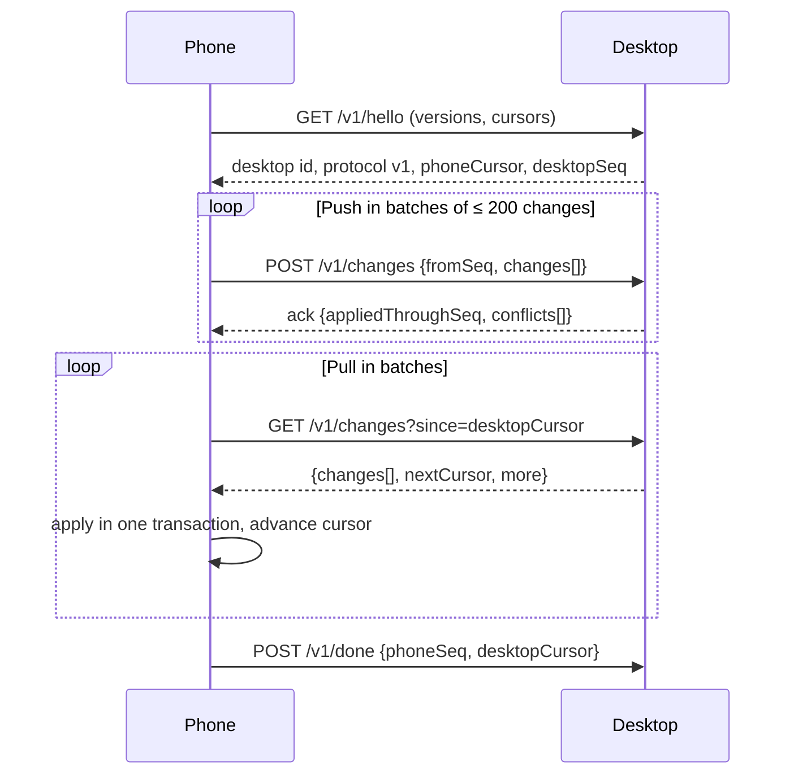

# 06 · Local Wi-Fi sync architecture

**Status: design only.** No sync code exists in Sprint 01, and the app never pretends otherwise:
Settings shows "Desktop sync isn't set up yet." This document fixes the decisions the Sprint 01
schema had to anticipate, and the plan for building it.

## Goals

1. Keep the phone and a desktop companion (React + TypeScript) in step when both are on the same
   Wi-Fi and the companion is running.
2. **The phone never depends on the desktop to teach.** Every feature works offline. Sync is a
   convenience, never a gate.
3. No cloud service, no account, no paid infrastructure.
4. Student data (including minors' names) never leaves the two paired devices.

Non-goals for v1: more than one phone, real-time collaboration, syncing over the internet,
syncing with the public website (that is a separate, later integration; see the end of this doc).

## Topology

- The **desktop runs the server** (it is plugged in and stays awake); the **phone is the client**
  and starts every sync. That keeps the phone free of listening sockets and background servers.
- Sync is **user-initiated or opportunistic in the foreground** (opening Settings › Sync, or the
  app noticing the paired desktop on launch). No background service is needed for v1.

## Discovery

- The companion advertises `_kaijucoach._tcp` over mDNS/DNS-SD with its device id and protocol
  version in TXT records.
- The phone uses `NsdManager`. Today the app targets API 36, where `INTERNET` still allows LAN
  access. **When the app moves to targetSdk 37, Android 17 blocks local-network traffic by
  default** behind `ACCESS_LOCAL_NETWORK` (NEARBY_DEVICES group). The plan is the
  privacy-preserving path: `NsdManager` discovery with `DiscoveryRequest.FLAG_SHOW_PICKER`, where
  the system shows a picker and the app may connect to the chosen device **without** the broad
  permission. Fallback: request `ACCESS_LOCAL_NETWORK` with a clear rationale.
- Manual fallback: type the address shown on the desktop, or scan its pairing QR code.

## Pairing and trust

One-time pairing, then no passwords:

1. The desktop shows a QR code (and a short code for manual entry) containing: addresses + port,
   desktop id, the SHA-256 fingerprint of its self-signed TLS certificate, and a single-use
   128-bit pairing secret that expires in 5 minutes.
2. The phone generates an EC P-256 key pair **in the Android Keystore** (non-exportable), opens a
   TLS connection, and **pins the certificate fingerprint** from the QR code.
3. It sends its public key and device id, authenticated with an HMAC of the pairing secret.
4. The desktop stores the phone's public key; the phone stores the desktop's fingerprint.

Every later request is TLS 1.3 to the pinned certificate and carries a signature over
method + path + body hash + timestamp + nonce, made with the Keystore key. The desktop rejects
unknown keys, stale timestamps and replayed nonces. Unpairing deletes the keys on both sides.

## Change tracking

The Sprint 01 schema already provides what sync needs per record: a stable UUID, `updatedAt`
and a `deletedAt` tombstone. Schema v2 adds two things before sync ships:

| Addition | Why |
|---|---|
| `hlc TEXT` on every synced row | A **hybrid logical clock** (wall time + counter + device id). Ordering by `updatedAt` alone breaks when a phone clock is wrong; HLC keeps causality and still sorts by time. |
| `change_log (seq INTEGER PRIMARY KEY AUTOINCREMENT, entity, entityId, hlc)` | Written in the same transaction as each repository change. A peer's progress is a single number: "I have everything up to seq N." |

**Sync units (aggregates).** Some tables change together and sync as one unit, replaced whole:

| Unit | Contains |
|---|---|
| Lesson plan | plan + segments + segment↔technique links |
| Student | student + enrollments |
| Class session | session row (segments snapshot, attendance and notes sync as their own records) |
| Everything else | one row |

## The sync exchange

- **Idempotent:** a change is `(entity, id, hlc, payload)`. Applying it twice is a no-op.
- **Interrupted sync is safe:** cursors move only after the receiving side commits a batch. A
  dropped connection resumes from the last acknowledged batch, with exponential backoff
  (2 s → 4 s → … max 60 s) and a visible "Retrying" state.
- **Schema versions:** `hello` exchanges both database versions; a mismatch stops sync with a
  message to update the older app, never a partial write.

## Conflicts

A conflict is the same unit changed on both devices since the last successful sync.

| Case | Rule |
|---|---|
| Both edited | Last writer by HLC wins, **and** the losing version is saved to `sync_conflict` so it can be reviewed in Settings › Sync ("Keep this version instead"). |
| Edit vs. delete | The newer HLC wins. A resurrected record is flagged for review. |
| Attendance for the same student and class | Last mark wins (a quick re-mark on the mat is the truth). |
| Session snapshot (`session_segment`) | Written only by the device that ran the class; never merged. |
| Notes | Separate records, so both sides' notes survive. |

## Media

Videos never travel inside a sync batch. Media rows (planned: title, tags, size, SHA-256, links to
techniques/lessons) sync like any record; files move in a **separate, resumable transfer** (HTTP
range requests, verified by hash), only on Wi-Fi, only when the instructor asks, and only for
files they own. The phone can keep a reference without a local copy.

## Status the user sees

| State | Shown as |
|---|---|
| Not paired | "Desktop sync isn't set up" (Sprint 01 shows exactly this) |
| Searching | "Looking for your computer on this Wi-Fi" |
| Syncing | Progress "Sending 40 of 120 changes" |
| Up to date | "Synced 6:52 PM with Earl's MacBook" |
| Pending | "12 changes waiting — your computer isn't on this network" |
| Error | Plain reason + Retry ("Your computer's certificate changed. Pair again.") |
| Conflicts | "2 items changed on both devices — review" |

## Backup and recovery

| Layer | Status |
|---|---|
| JSON export to a file the instructor picks | **Built in Sprint 01** |
| JSON restore with preview and validation | Sprint 02 |
| Automatic local copy of the database before any migration or sync merge (kept: last 3) | Sprint 02 |
| Desktop keeps dated snapshots of received data | With the companion |

Android cloud backup and device-to-device transfer are **disabled** for this app
(`data_extraction_rules.xml`), so student records are never copied to a Google account.

## Website integration (later, separate)

The public site's Cloudflare Worker + D1 inquiry flow stays as it is. A later integration will add
instructor-only authentication to the Worker and let the app pull authorized inquiries into a
separate `inquiry` table. Converting an inquiry into a student is a deliberate action in the app.
Public visitors never get a path to instructor records.

## Delivery plan

| Sprint | Sync work |
|---|---|
| 02 | Schema v2 (`hlc`, `change_log`, `sync_conflict`) with migration tests; JSON restore; pre-migration auto-backup |
| 03 | Desktop companion skeleton + local sync service; discovery; pairing |
| 04 | Push/pull, conflicts, status UI, failure tests (airplane mode mid-batch, clock skew, duplicate delivery) |
| 05 | Media metadata + resumable file transfer |
