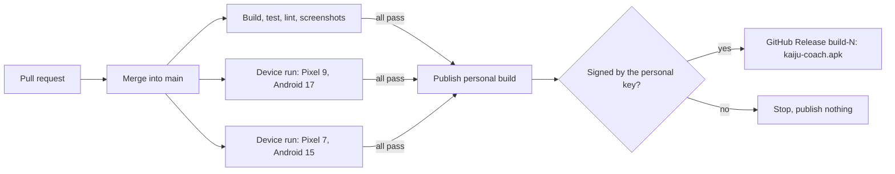

# 10 · Personal builds: Kaiju Coach on Earl's Pixel 9

How the app gets onto the phone, how it updates without losing data, and where the signing
keys live. Set up on 2026-11-16 (ADR-013).

## Two apps on the phone

| | **Kaiju Coach** (personal build) | **Kaiju Test** (debug build) |
|---|---|---|
| For | Real classes, lesson plans and students | Trying changes, sample data, the automated phone test |
| Package | `com.earlthekaiju.coach` | `com.earlthekaiju.coach.debug` |
| Comes from | GitHub Releases, after a merge into `main` passes every check | CI on every push, or Android Studio |
| Signed by | The personal release key | The CI debug key (Android Studio uses the Mac's own debug key) |
| *Load sample data* | No | Yes, in Settings |
| Data | Its own | Its own |

They never share data, and installing or removing one leaves the other alone.

## Install it on the Pixel (first time)

1. On the phone, open Chrome and go to
   **https://github.com/Epetaway/earltheKaiju_app/releases/latest/download/kaiju-coach.apk**.
   Bookmark it: the same link always gets the newest build.
2. Chrome downloads `kaiju-coach.apk`. Tap **Open** (or open it from Downloads).
3. The first time, Android says Chrome isn't allowed to install unknown apps. Tap **Settings**,
   turn on **Allow from this source**, and go back.
4. Tap **Install**. Google Play Protect may scan the app first, or ask to. Let it: it hasn't
   seen this app before because it isn't on the Play Store.
5. Open Kaiju Coach. **Settings › About** shows the version and build number, for example
   *Version 0.1.0 · build 57*. It matches the release title on GitHub.

You can turn **Allow from this source** off again afterward (Settings › Apps › Special app access
› Install unknown apps › Chrome). Turn it back on for the next update.

## Update it

Open the same link. Android asks *Do you want to update this app?* Tap **Update**. Your classes,
lessons, students and attendance stay. Compare the build number in Settings › About with the
newest release to see whether you're current.

Two things can't install over the app you have, and Android will say so instead of installing:
- **An older build over a newer one.** Android blocks downgrades.
- **An APK signed by a different key**, such as a build you made in Android Studio. CI refuses to
  publish one (see below), so this only happens with an APK from somewhere else.

**Never uninstall Kaiju Coach to get past an install error.** Uninstalling deletes everything in
it. Export a backup first (Settings › Export backup). Restoring from a backup isn't built yet, so
for now the export is your record, not a one-tap undo.

## Where the builds come from



- The **Publish personal build** job runs only for `main`, only after every other job passes. It
  builds the release APK, checks that its signing certificate matches `RELEASE_CERT_SHA256` in
  the workflow, and publishes it as the latest release, tagged `build-<CI run number>`.
- The CI run number is also the app's version code, so every build is newer than the last one.
- Each release note lists the commit, the signing certificate's SHA-256 and the APK's SHA-256.
- The 10 newest releases are kept; older ones are deleted.
- **The releases are public**, like the repository (ADR-012). The APK holds no keys and no data:
  anyone who installs it gets an empty app on their own phone. Revisit if the repository goes
  private, because release downloads would then need a GitHub sign-in on the phone.

To publish without merging anything (for example right after adding the secret below): GitHub ›
Actions › Android CI › **Run workflow** on `main`.

## The signing keys

Android lets an update install over an app only if both are signed with the same key. So the
personal build's key has to stay the same for as long as the app is on the phone.

| Key | Signs | Certificate SHA-256 (public) |
|---|---|---|
| `release` | Kaiju Coach, the personal build | `36:F0:A2:F2:05:A3:65:E6:D5:2D:8E:63:92:F0:7D:5E:CB:71:4A:D1:BB:3D:5A:06:6F:3B:E3:1D:B5:3C:F2:8E` |
| `ci-debug` | Kaiju Test builds from CI | `68:E0:A6:64:04:7A:98:6D:CC:70:67:5D:DE:76:90:9B:F8:4A:FE:AC:41:56:A3:50:9C:D3:CD:4E:EF:37:B3:E1` |

**Where they live.**
- **GitHub:** the repository secret `KAIJU_SIGNING_BUNDLE`, which is base64 of a `.tar.gz` holding
  `release.p12`, `release.password`, `ci-debug.p12` and `ci-debug.password`. Both keys are
  PKCS12 and 4096-bit RSA, valid until 2054.
- **Earl's password manager:** the same bundle file, as the backup. GitHub never shows a secret
  again once it's saved.
- **Never in git.** `.gitignore` blocks `*.p12`, `*.jks`, `*.keystore`, `private/` and `secrets.*`.

**Who sees which key.**
- `.github/scripts/unpack-signing.sh` unpacks only the keys a job names: debug jobs get
  `ci-debug`, and only the publish job, on `main`, gets `release`.
- The passwords are masked in the logs.
- Gradle finds the keys through `KAIJU_SIGNING_DIR` (see `android/app/build.gradle.kts`).

**Without the secret**, CI still passes:
- debug builds use a throwaway key, as they did before;
- the build job signs the release APK with a throwaway key, only to prove signing works;
- the publish job skips with a notice.

**If both copies of the key are lost**, a new key can't update the installed app. Every phone
would have to export a backup, uninstall and reinstall. That's why the backup matters.

### First-time setup (done once)

1. Earl adds the secret: GitHub › repository **Settings › Secrets and variables › Actions › New
   repository secret**. Name `KAIJU_SIGNING_BUNDLE`; the value is the whole bundle file (on a Mac,
   `pbcopy < KAIJU_SIGNING_BUNDLE.txt`, then paste).
2. He saves the bundle file in his password manager, then deletes the local copy.
3. Run the workflow on `main` (above) to publish the first build.

The bundle was generated with `keytool` in a private working folder, handed to Earl's Mac in a
git-ignored folder, and deleted from the working folder after the first signed release was
verified. Its passwords were never printed or committed.

### Signing a build on the Mac (rarely needed)

Android Studio's debug builds use the Mac's own debug key, so they can't update a Kaiju Test
installed from CI. Uninstall Kaiju Test first; it only holds test data. To sign a release build
locally with the personal key:

```bash
mkdir -p ~/kaiju-signing && cd ~/kaiju-signing
base64 -D -i /path/to/KAIJU_SIGNING_BUNDLE.txt | tar -xz      # macOS base64
cd /path/to/earltheKaiju_app/android
KAIJU_SIGNING_DIR=~/kaiju-signing KAIJU_BUILD_NUMBER=<newer than the phone's> ./gradlew assembleRelease
rm -rf ~/kaiju-signing
```

## Running the automated phone test on the Pixel

`android/scripts/run-on-phone.sh` works over USB or wireless debugging (README). It installs
Kaiju Test and its test package, runs the class flow, and pulls back screenshots. It never
installs over, or removes, the personal build.

To turn on debugging on the Pixel:
1. Open Settings › About phone and tap **Build number** seven times.
2. In Settings › System › Developer options, turn on **USB debugging** or **Wireless debugging**.

Builds from CI share the debug key, so each run installs over the last. The first CI build signed
with the shared key can't install over a Kaiju Test from an earlier build. Uninstall that one
Kaiju Test once; it only ever held test data.

## Coming in 2027: Android developer verification

Google is starting to require that apps installed on certified Android phones come from
registered developers.
- **Where it applies now:** Brazil, Indonesia, Singapore and Thailand, since 2026-09-30.
- **Elsewhere:** the global rollout, including the US, is planned for 2027, with no US date
  announced as of late October 2026.
- **Until then:** installing from Chrome on a US phone works as described above.

When it reaches the US, the options are:
- Register Kaiju Coach under a free limited-distribution developer account, which covers up to 20
  devices. Registration ties the package name to its signing certificate, so the stable key above
  carries over.
- Keep installing over adb.
- Use the "advanced flow": a Developer options setting with a one-time 24-hour wait.

Sources: [Android Developers Blog, 2026-03-30](https://developer.android.com/blog/posts/android-developer-verification-rolling-out-to-all-developers-on-play-console-and-android-developer-console) ·
[9to5Google, 2026-08-18](https://9to5google.com/2026/08/18/google-gradually-rolling-out-androids-advanced-sideloading-ahead-of-developer-verification/) ·
[WhistleOut, updated 2026-10-26](https://www.whistleout.com/CellPhones/Guides/how-to-sideload-apps-on-android)
