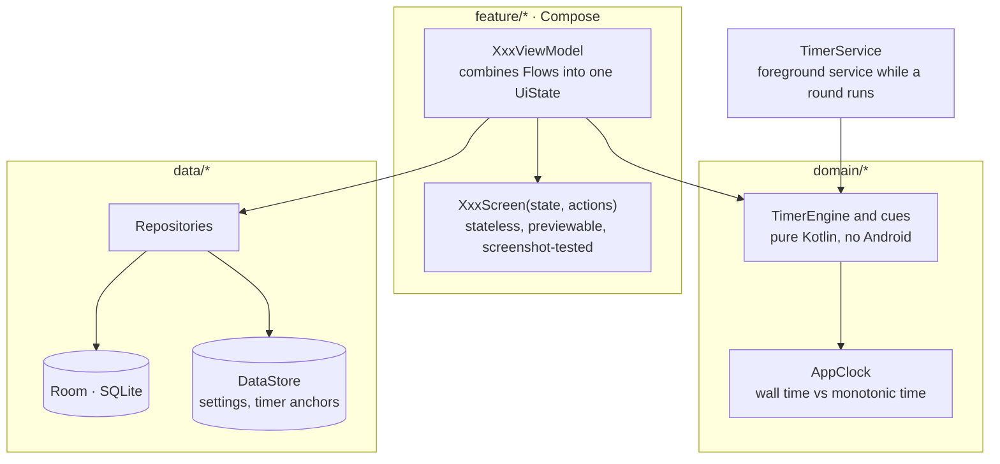

# 3. Architecture

[← Design](02-design.md) · Next: [Key decisions →](04-decisions.md)

One Android app module, organized by feature, with a thin data layer over Room. It's built for one instructor and one maintainer, so every layer has to earn its place. The full version is [`02-architecture.md`](../02-architecture.md).

## Layers



**Stack:** Kotlin 2.4 with AGP 9's built-in Kotlin support, Compose with Material 3 as a restyled foundation, type-safe Navigation Compose routes, Room 2.8 with KSP, DataStore, Coroutines/Flow, kotlinx.serialization, Media3 for video, and a manual dependency container (`AppContainer`) instead of Hilt. Versions were checked against official release pages and proven by a passing CI build ([`09-dependency-verification.md`](../09-dependency-verification.md)).

## Offline-first by design

There's no server, and no feature uses the network. Room on the phone is the source of truth, because classes happen without reliable signal and the phone must never wait on anything ([ADR-002](../decisions.md)).

Sync was planned from the first schema. Stable UUIDs, `updatedAt` timestamps and tombstones for deletions are in schema v1, so desktop sync won't need a rewrite ([`06-sync-architecture.md`](../06-sync-architecture.md), [`05-data-model.md`](../05-data-model.md)).

## A timer you can trust

The countdown is never "subtract one each second." A run stores anchors on `SystemClock.elapsedRealtime()`, which keeps counting in deep sleep and ignores wall-clock changes. Each displayed value is derived from them:

```
active    = (pausedAt ?: now) - startedAt - pausedAccumulated
remaining = currentInterval.end - active     // shown rounded up to whole seconds
```

- Dropped frames, a slow phone or the app being frozen change nothing.
- The anchors are saved, so the timer survives the app being killed.
- Since Sprint 02, a foreground service holds a partial wake lock only while a round runs, so bells ring on time with the phone locked.
- Cues play on the alarm audio stream, so turning music down doesn't silence the bell ([ADR-014](../decisions.md)).

Limits are spelled out in [`07-timer-platform-behavior.md`](../07-timer-platform-behavior.md). For example, a reboot mid-round loses the run, and that case is detected and handled.

## Past classes stay true

Starting a class copies the lesson's segments and technique names into the session ([ADR-006](../decisions.md)). Editing a template later doesn't rewrite what was actually taught. The duplicated text is intentional.

## Build pipeline

GitHub Actions is the build machine (`.github/workflows/android.yml`):

1. **Build, test, lint, screenshots:** assembles debug and release APKs, checks their signatures, runs unit and Robolectric tests, renders every screen with Roborazzi, and runs Android lint.
2. **Device run:** boots emulators (a Pixel 7 on Android 15, a Pixel 9 on Android 17) and drives a full class from an empty app with accessibility checks on every tap.
3. **Publish personal build:** after a merge into `main` passes, CI signs the release APK with my personal key, confirms the certificate fingerprint and publishes it as a GitHub Release at a fixed link. The phone updates in place and keeps its data ([ADR-013](../decisions.md), [`10-personal-builds.md`](../10-personal-builds.md)).

Reports go to a `ci-reports` branch so screenshots stay out of `main`'s history ([ADR-007](../decisions.md)).
