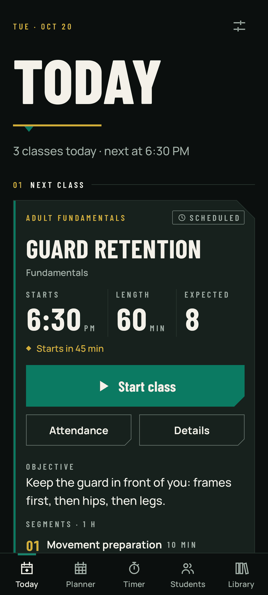
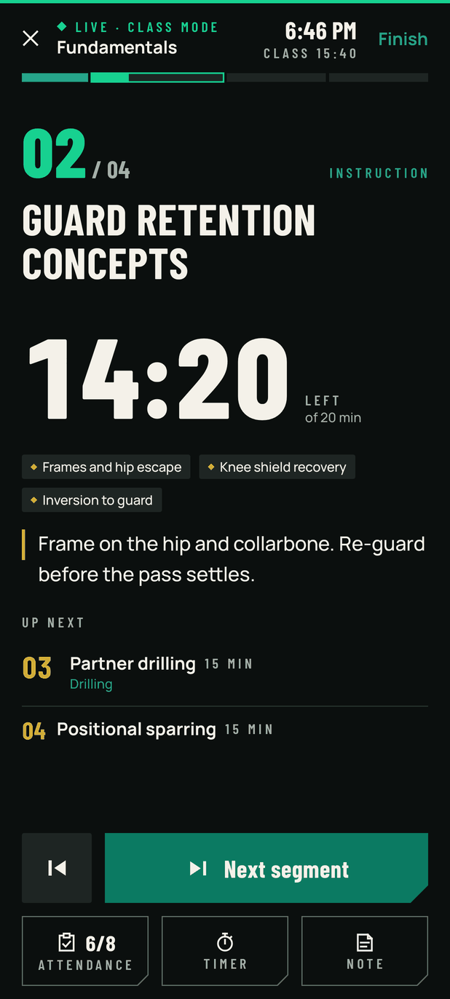
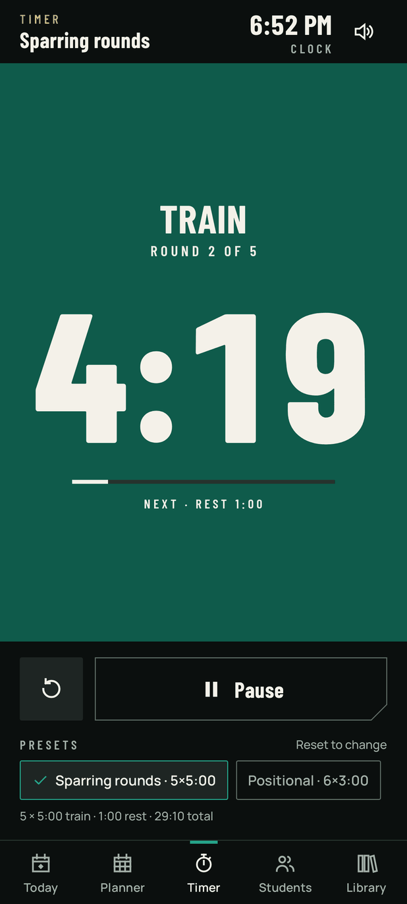
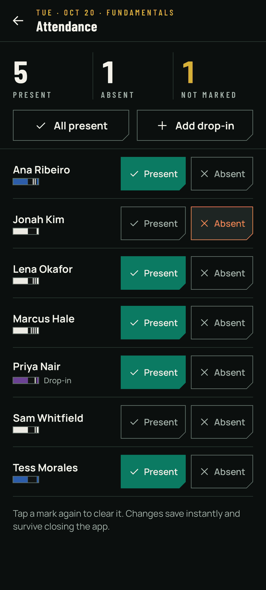

# Kaiju Coach: Project Wiki

Kaiju Coach is a private Android app I use to teach Brazilian Jiu-Jitsu. It holds today's class, lesson plans, a round timer, attendance and my student roster, and it works with no internet connection. It's part of my **Earl the Kaiju** brand: the same identity I designed, now in a working tool.

This wiki is the guided tour for people evaluating my work. The detailed specs it links to are in [`docs/`](../).

> **Status:** Three sprints merged (Oct 20 to Nov 18, 2026). Sprint 01 built the core teaching flow. Sprint 02 added a timer that keeps running with the phone locked. Sprint 03 added a private technique-video library. Desktop sync is designed, not built. The app hasn't been used to teach a real class yet; that's the test that matters most.

| Today | Class Mode | Timer | Attendance |
|---|---|---|---|
|  |  |  |  |

*Rendered by CI from the real Compose code, with fictional data.*

## The short version

| | |
|---|---|
| **My role** | Product owner, designer, brand owner and the app's only user. I set the brief, the design direction and every decision record. The Kotlin was written by an AI coding agent working from my briefs, and I reviewed it, ran it on my phone and signed off on each sprint (see [How I worked](06-challenges-and-lessons.md#how-i-worked-with-an-ai-coding-agent)). |
| **Stack** | Kotlin, Jetpack Compose, Room, DataStore, Coroutines/Flow, Navigation Compose, Media3; JUnit, Robolectric, Roborazzi; GitHub Actions |
| **Scale** | About 13,000 lines of Kotlin; 10 feature areas; 75 tests plus an instrumented full-class device test; 45 rendered screen states |
| **Hardest problems** | A timer you can trust mid-round; layouts that survive 200% text, landscape and 3-button navigation; getting updates onto a phone without losing real data |

## Read in this order

1. **[Overview](01-overview.md)**: the problem, the user, and what's built
2. **[Design](02-design.md)**: turning a brand identity into a tool you can read from across the mat
3. **[Architecture](03-architecture.md)**: layers, offline-first data, the timer, and the build pipeline
4. **[Key decisions](04-decisions.md)**: six of the fifteen decision records, in plain language
5. **[Quality](05-quality.md)**: the testing ladder and the 33 QA findings
6. **[Challenges and lessons](06-challenges-and-lessons.md)**: what each step of testing caught, how I worked with an AI agent, and what's next

## Questions I'd enjoy being asked about

- Why is the timer computed from a monotonic clock instead of counting ticks?
- Why does starting a class copy the lesson plan instead of linking to it?
- What did the real phone catch that the emulator didn't?
- Why play the bell on the alarm audio stream?
- Why native Kotlin instead of React Native, when my day job is React?
